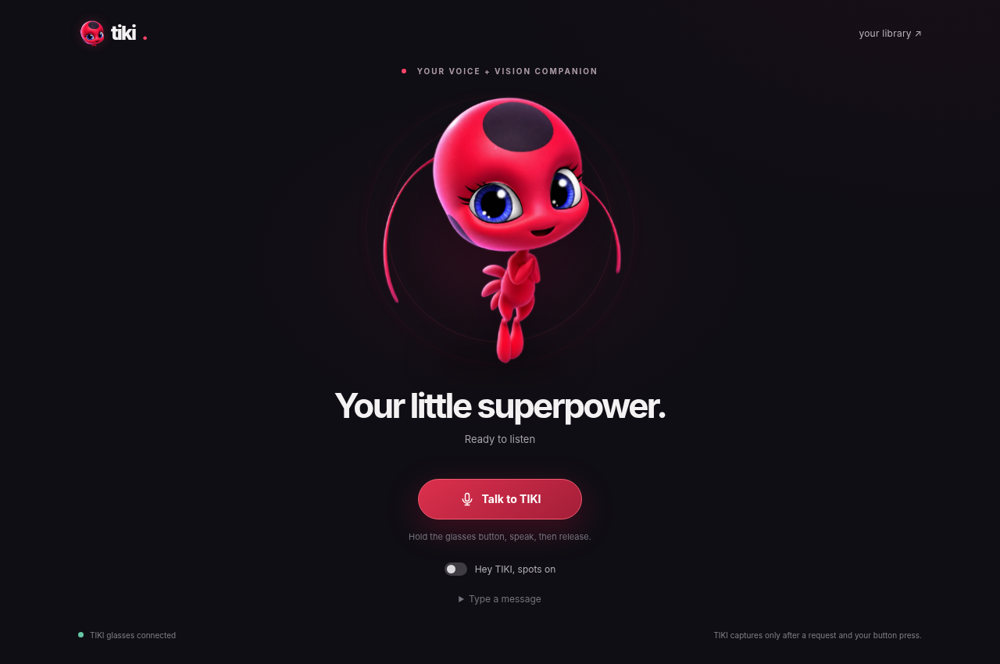
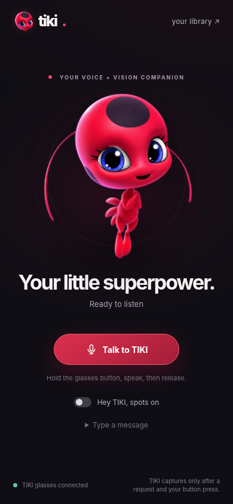

# TIKI

**A wearable AI companion that sees, understands, and remembers.**

TIKI is an ESP32-S3 smart-glasses **MVP** combining a physical camera button, a front-facing camera, a hardware speaker, Gemini-powered visual understanding, and a searchable local visual memory. The Mac currently handles microphone input and AI processing; the glasses capture pictures and play answers through the attached speaker.



## Demo

**Live hardware footage coming soon.** This repository currently includes screenshots of the real app interface. The demo video and prototype photographs can be added to `docs/` and linked here when available.



### The interaction

1. Use **Talk to TIKI** in the browser to ask a question (for example, “TIKI, look at this and tell me what you see”).
2. Point the glasses camera at the scene and **tap the physical camera button**. The physical button is **camera-only**, not a microphone button.
3. TIKI captures a JPEG, stores it locally, and requests a visual description.
4. The reply is played through the **physical speaker attached to the ESP32**, and the image and description remain available in the photo library.
5. Ask TIKI about an earlier photo to retrieve saved visual memory.

## Features

- **Camera-only hardware button:** one tap requests a photo capture.
- **Vision:** describes objects, handwriting, and scenes; can offer uncertain guesses about breeds.
- **Persistent photo memory:** saves original JPEGs and their descriptions for later retrieval.
- **Voice:** browser Talk uses the Mac microphone; the physical ESP32 speaker plays replies.
- **Reminders and notes:** saved locally, with confirmation for suggested tasks.
- **Minimal mascot interface:** TIKI reacts to listening, thinking, and speaking states.
- **Optional:** offline wake phrase on the Mac (Vosk) and YOLO generic object tags.

## Architecture

```text
  Talk button (browser) --> Mac microphone --> FastAPI / Gemini
                                               |         ^
                                        voice  |         | photo
                                               v         |
                                      ESP32-S3 + OV3660 camera
                                      |         |         |
                                    speaker   button   red LED

                              Local SQLite and JPEG photo library
```

The Mac and ESP32 must be on the **same local Wi-Fi network**. TIKI does not have an onboard microphone in this MVP. The Mac server must remain running for voice and memory functions.

## Hardware

- ESP32-S3 with camera / PSRAM
- OV3660 camera
- MAX98357A I2S amplifier and small speaker
- Physical camera push button
- Camera-status LED and appropriate resistor
- Insulated connections and suitable USB power supply

`firmware/TIKI_Permission_Camera.ino` is a reference sketch. **Keep an already working ESP32 firmware version unless there is a specific reason to change it.** Before wearing, insulate electronics, secure the wiring, and test for abnormal heating off your face.

## Run locally (macOS)

```bash
git clone https://github.com/desharajudevihasini/TIKI.git
cd TIKI
python3 -m venv .venv
source .venv/bin/activate
python -m pip install -r requirements.txt
cp .env.example .env
```

Open `.env` privately and set `GEMINI_API_KEY` to your own key and `TIKI_ESP_URL` to the **current** address shown in Arduino Serial Monitor at 115200 baud. Leave `TIKI_AI_MODEL=auto` and `TIKI_MAC_BRIDGE=1` for the MVP.

Test hardware connectivity:

```bash
curl --max-time 5 http://YOUR_ESP32_IP/status
python tools/preflight.py --beep
python tools/check_camera_button.py
```

Then start TIKI:

```bash
python -m uvicorn app.main:app --host 127.0.0.1 --port 8002
```

Visit **http://localhost:8002** in Chrome. Allow microphone access if prompted.

If the speaker reports “No route to host,” check the current ESP32 IP. A local DHCP address can change; do not hard-code an old one. If the button counter never changes on the ESP32, check the GPIO40-to-GND button circuit before debugging the Python server.

## Project structure

```text
app/                   AI, FastAPI, audio, visual memory and hardware bridge
frontend/              TIKI browser interface and mascot
firmware/              ESP32 reference firmware
models/                (optional local downloads; ignored by Git)
tests/                 Software tests with simulated services/hardware
tools/                 Hardware diagnostics
docs/                 App screenshots and demo guide
.env.example           Example setup, no secret values
requirements.txt       Python dependencies
```

To run tests: `python -m pip install pytest && python -m pytest tests -q`.

## Privacy and limitations

This is a hardware **MVP**, not a standalone production device. No onboard microphone is currently installed; a nearby Mac handles speech input and Gemini processing. Latency can vary with cloud service load and Wi-Fi. Photos and memories are stored locally under `data/` (excluded from Git), but authorized requests to Gemini send audio or image content to an external service. Do not publish the local ESP32 or Mac hardware-control endpoints to the public internet. Ask permission before capturing other people's images.

**Repository safety:** `.env`, private photos, SQLite databases, Python virtual environments and downloaded models are excluded by `.gitignore`. Never commit an API key or Wi-Fi password.

For the recording flow and media checklist, see [docs/DEMO_GUIDE.md](docs/DEMO_GUIDE.md).
